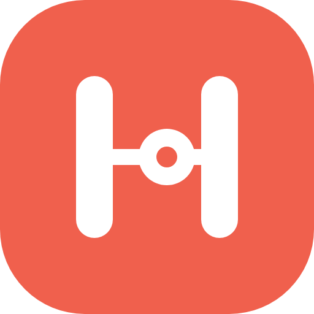
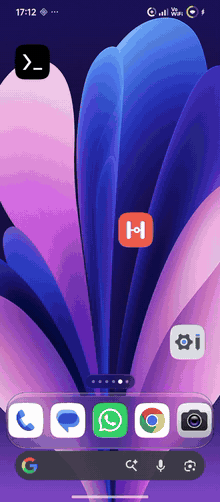
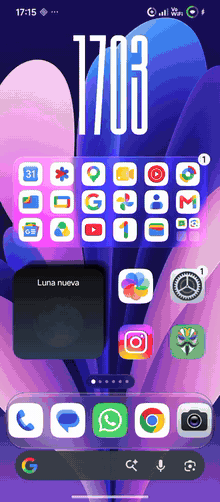
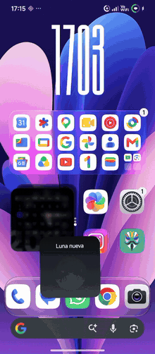
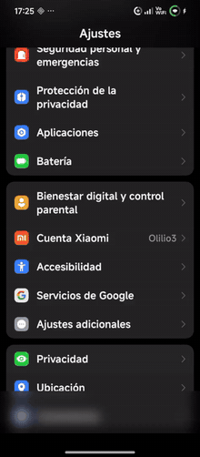
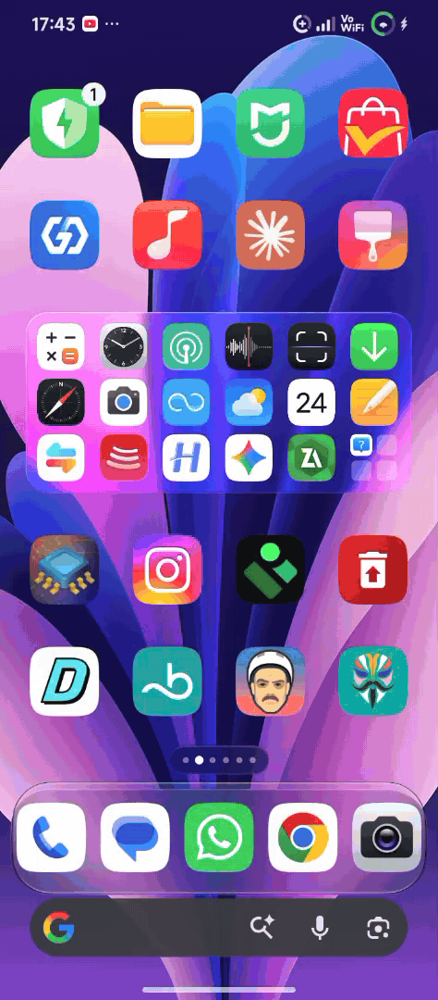
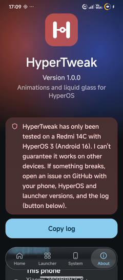

  

<h1 align="center">HyperTweak</h1>

  Animaciones y cristal líquido para HyperOS · módulo LSPosed 
  <b>v1.0.0</b> · <a href="README.md">English</a>

---

> **Nota sobre el desarrollo:**  
> Este proyecto se diseñó inicialmente con ayuda de IA, pero actualmente estoy aprendiendo Java para reescribir, mantener y programar todo por mí mismo. ¡Cualquier sugerencia o contribución es bienvenida!

HyperTweak añade al launcher y a la interfaz del sistema de HyperOS animaciones que no trae de serie y un centro de control de cristal líquido con refracción en el borde. No modifica ningún APK: todo se hace con LSPosed. Los deslizadores se aplican al momento desde la app; activar o desactivar una función requiere reiniciar el launcher o la interfaz del sistema.

> [!WARNING]
> **Solo se ha probado en un Redmi 14C con HyperOS 3 (Android 16).** No se asegura que funcione en otros dispositivos. Si algo falla, abre un *issue* con tu móvil, la versión de HyperOS y del launcher, y el registro (**Acerca de → Copiar registro**). Cada función se instala por separado: si una falla, se anota en el registro y las demás siguen funcionando. Si el launcher o la interfaz se cierran varias veces seguidas, HyperTweak se desactiva solo en esa parte (ver [Modo seguro](#modo-seguro)).

## Vista previa

<table>
  <tr>
    <th>Abrir y cerrar apps</th>
    <th>Carpetas y pila de widgets</th>
    <th>Recientes que se doblan</th>
  </tr>
  <tr>
    <td></td>
    <td></td>
    <td></td>
  </tr>
</table>

<table>
  <tr>
    <th>Cortina entre pantallas</th>
    <th>Centro de control de cristal líquido con el iOS Control Center de Mods Center</th>
    <th>La app</th>
  </tr>
  <tr>
    <td></td>
    <td></td>
    <td></td>
  </tr>
</table>

Toca un GIF o la captura de la app para ver el vídeo completo a hasta 60 fps. Los GIF están recortados y van a menos fotogramas para que pesen poco. Grabado con scrcpy en un Redmi 14C con HyperOS 3.

## Requisitos

| | |
|---|---|
| **Sistema** | HyperOS 2 o 3 (Android 13 o superior). El cristal y la refracción necesitan Android 13+. |
| **Root** | Magisk, KernelSU o APatch. Concede root a la app HyperTweak para que los botones de reiniciar funcionen al momento. |
| **LSPosed** | LSPosed (Zygisk) o un fork actual, como JingMatrix/Vector. API de Xposed 93+. |
| **Ámbitos** | `com.miui.home` (Launcher del sistema) y `com.android.systemui` (Interfaz del sistema). Si LSPosed lo muestra, marca también `miui.systemui.plugin`. |

### Con qué se ha probado

- **Móvil:** Redmi 14C (Helio G81 Ultra, Mali-G52 MC2) con HyperOS 3 (Android 16).
- **Mods de Kashi, de Mods Center:**
  - *HyperOS Launcher Mod 7.5*: escritorio.
  - *iOS Control Center*: centro de control.

**Los mods de Mods Center no son obligatorios.** HyperTweak también funciona con el launcher y el centro de control de serie de HyperOS. La pila de widgets y las carpetas que cambian de tamaño son funciones del launcher de Kashi: con el de serie, esas dos partes no hacen nada.

## Qué hace

### Escritorio (`com.miui.home`)
- **Efecto genio al abrir y cerrar apps.** La ventana sale del icono y vuelve a él con forma de copa. La parte de arriba se adelanta y la de abajo la sigue, adaptándose a la altura del icono. Hay tres estilos: genio clásico, copa tipo Samsung y copa «Ice», más suave y con rebote. Se dibuja con OpenGL en un hilo propio para que vaya fluido en gama media.
- **Arrastrar para cerrar como una lámpara.** La ventana cuelga del dedo y se balancea.
- **Recientes que se doblan** según la fuerza con la que deslizas las tarjetas.
- **Iconos que se hunden** al pulsarlos y **zoom del fondo** al abrir apps.
- **Carpetas** con cristal desenfocado y un muelle al cambiar de tamaño.
- **Pila de widgets** con baraja y arrastre libre.

### Interfaz del sistema (`com.android.systemui`)
- **Telón:** al cambiar de pantalla dentro de una app, la ventana se inclina según su velocidad y la de debajo se desenfoca.
- **Centro de control de cristal líquido:**
  - Desenfoque, saturación, lupa y brillo.
  - Canto iluminado con el color de lo que hay detrás.
  - **Refracción en el borde** con dispersión de color, basada en la lente de [AndroidLiquidGlass](https://github.com/Kyant0/AndroidLiquidGlass).

### La app
- Colores del sistema (Monet), barra flotante de cristal líquido, fondo de puntos animado y tema oscuro.
- En español o inglés según el idioma del móvil (se puede cambiar en **Acerca de → Idioma**).
- **Cada ajuste explica para qué sirve:** toca la fila para desplegar la explicación y mantenla pulsada para volver a su valor por defecto.
- En **Acerca de**, una tarjeta de compatibilidad muestra tu versión de Android y HyperOS, la del launcher y la del centro de control, y si HyperTweak está activo en cada parte.
- **Registro** del
