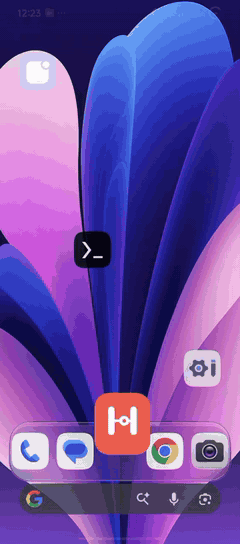
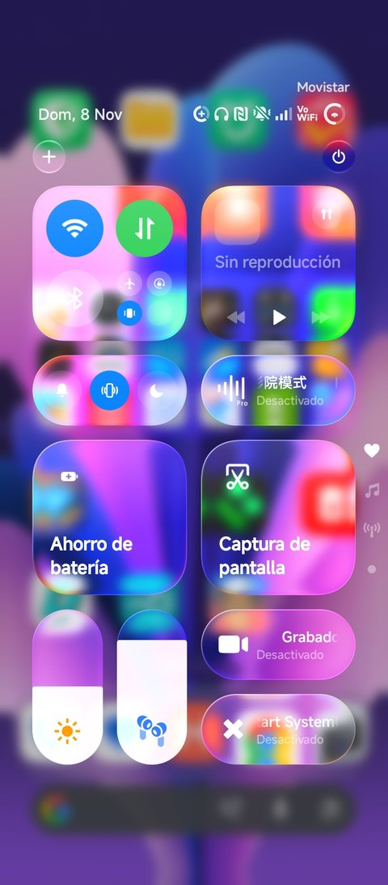
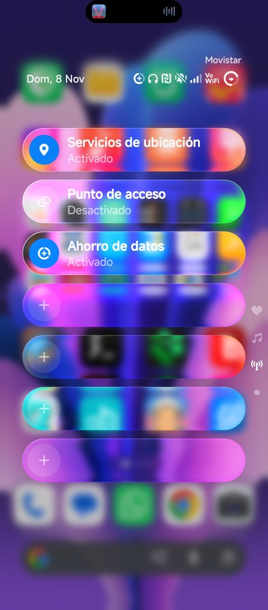

  

<h1 align="center">HyperTweak</h1>

  Animations and liquid glass for HyperOS · LSPosed module 
  <b>v1.0.0</b> · <a href="README.es.md">Español</a>

---

> **A Note on Development:**  
> This project was initially built using AI to prototype the core concepts quickly. However, I am currently learning Java and **looking forward to** refactoring, maintaining, and coding everything myself as I grow as a developer! Feedback and contributions are more than welcome.

HyperTweak adds two kinds of things to HyperOS:
- **Launcher and System UI animations** that it doesn't ship with.
- **A liquid-glass control center** with edge refraction.

It doesn't modify any APK: everything runs through LSPosed and most settings apply live from the app.

> [!WARNING]
> **Only tested on a Redmi 14C with HyperOS 3 (Android 16).** I can't guarantee it works on other devices.
> - **If something breaks:** please open an [issue](../../issues) and paste the log from **About → Copy log**. It already includes your phone and the HyperOS and launcher versions.
> - **If a part fails on your device:** each feature is installed separately, so the error is written to the log and the rest keeps working.
> - **If the launcher or System UI crashes repeatedly:** HyperTweak turns itself off in that part (see [Safe mode](#safe-mode)).

## Preview

<table>
  <tr>
    <th>Genie effect</th>
    <th>Folders and widget stack</th>
    <th>Bending recents</th>
  </tr>
  <tr>
    <td></td>
    <td></td>
    <td></td>
  </tr>
</table>

<b>Liquid-glass control center</b> · with the Mods Center iOS Control Center

<table>
  <tr>
    <td></td>
    <td></td>
  </tr>
</table>

Tap a GIF to watch the higher-quality video. Recorded on a Redmi 14C with HyperOS 3.

## Requirements

| | |
|---|---|
| **System** | HyperOS 2 or 3 (Android 13 or newer). The glass and refraction need Android 13+. |
| **Root** | Magisk, KernelSU or APatch. Grant root to the HyperTweak app so the restart buttons work instantly. |
| **LSPosed** | LSPosed (Zygisk) or a current fork such as JingMatrix/Vector. Xposed API 93+. |
| **Scopes** | `com.miui.home` (System launcher) and `com.android.systemui` (System UI). If LSPosed lists it, also tick `miui.systemui.plugin`. |

### Tested with

- **Phone:** Redmi 14C (Helio G81 Ultra, Mali-G52 MC2) on HyperOS 3 (Android 16).
- **Kashi's mods from Mods Center:** *HyperOS Launcher Mod 7.5* (launcher) and *iOS Control Center* (control center).

**The Mods Center mods are not required.** HyperTweak also works with the stock HyperOS launcher and control center. The widget stack and the springy folders hook features of Kashi's launcher, so with the stock launcher those two do nothing.

## Features

### Launcher (`com.miui.home`)
- **Genie effect when opening and closing apps.**
  - The window comes out of its icon and goes back into it as a cup.
  - The top leads and the bottom follows, adapting to where the icon sits on screen.
  - Three styles: classic genie, Samsung-like cup and "Ice" (softer, with a bounce).
  - Drawn with OpenGL on its own thread so it stays smooth on mid-range phones.
- **Drag to close like a lamp:** the window hangs from your finger and swings.
- **Bending recents:** cards bend depending on how hard you swipe.
- **Sinking icons** when pressed, and **wallpaper zoom** when opening apps.
- **Folders** with blurred glass and a springy resize.
- **Widget stack** you can shuffle and drag freely.

### System UI (`com.android.systemui`)
- **Curtain:** when you switch screens inside an app, the window tilts with its speed and the one below blurs.
- **Liquid-glass control center:**
  - Blur, saturation, magnifier and gloss.
  - An edge lit with the colour of what's behind it.
  - **Edge refraction** with colour dispersion, based on the [AndroidLiquidGlass](https://github.com/Kyant0/AndroidLiquidGlass) lens.

### The app
- **Look:** system colours (Monet), a floating liquid-glass bar, an animated dot-network background and a dark theme.
- **Language:** English or Spanish depending on your phone's language. You can change it in **About → Language**.
- **Every setting explains itself:** tap a row to expand its description, and long-press it to reset it to its default.
- **Compatibility card** in **About**: your Android and HyperOS versions, the launcher and control center versions, and whether HyperTweak is active in each part.
- **Log** of the launcher and System UI, to copy when reporting a problem.

## Installation

1. Install the APK from [Releases](../../releases).
2. In LSPosed, enable **HyperTweak** and tick the **System launcher** and **System UI** scopes.
3. Reboot.
4. Open HyperTweak and grant root when asked (it's only used to restart the launcher and System UI).
5. In **About → Compatibility**, every part should show **Active**.

### Coming from Ice Home, Telón or KashiPlus
HyperTweak merges those three modules into one.
- **Ice Home:** HyperTweak installs over it and keeps your settings, because it uses the same package (`com.icehome.up`).
- **Telón and KashiPlus:** uninstall them and remove them from LSPosed. While they're installed, HyperTweak doesn't load that part (two hooks on the same thing would break System UI), and the app tells you so.

### Updating
1. Install the new version over the old one.
2. Restart the launcher and System UI from the **Home** tab, or reboot.

If a part is still running the previous version, the app tells you.

## Safe mode

- **Launcher:** if it crashes and restarts 4 times within a minute, HyperTweak stops loading its animations there. The launcher keeps working normally.
- **System UI:** if it restarts several times in a row, the curtain and the control center glass are turned off.

In both cases the app shows a notice with a **Turn back on** button.

If the phone doesn't boot properly, disable the module in LSPosed, or boot into Magisk/KernelSU safe mode.

## Troubleshooting

| Problem | What to do |
|---|---|
| **Compatibility** shows "Not detected" | Check that the module and both scopes are enabled in LSPosed, then reboot. |
| I turn a feature on or off and nothing changes | Launcher features and the curtain apply after restarting the launcher or System UI: **Home → Restart…**. Grant root to HyperTweak so the restart is instant. |
| The restart buttons don't work | Grant root to HyperTweak in Magisk, KernelSU or APatch. Without root, HyperTweak asks System UI to do it, which may not work on every phone. |
| The control center has no glass | Restart System UI from **Home**. Control centers other than the stock one and the Mods Center iOS one may not be recognised; send the log. |
| It stutters | Lower **Resolution** and set **Frames per second** to your screen's refresh rate (in *Launcher → Opening and closing apps* and in *System → Curtain*). |

## Building

- **With the Android SDK:** `./gradlew assembleRelease`.
- **Without the SDK:** `TOOLS=/path bash local-build/build.sh`.
  - Uses JDK 17, the API 35 `android.jar`, jadx (D8), apktool (aapt2) and uber-apk-signer.
  - The version comes from `Version.java`.
  - The APK ends up in `local-build/out/HyperTweak.apk`.
- **Shader checks:** the AGSL shaders are validated with skia-python before building, and the OpenGL ones with Mesa (scripts in `local-build/`[cite: 2]).

### Layout
- `com.icehome.up`:
  - Launcher features: genie, recents, folders, widget stack.
  - The app: settings, glass bar, translations (`I18n`) and settings provider.
  - LSPosed entry point (`MainHook`).
- `com.icehome.up.telon`: curtain transitions and the System UI safe mode.
- `com.icehome.up.cc`: control center liquid glass.
- [`docs/TECHNICAL.md`](docs/TECHNICAL.md): how each animation works and which methods are hooked (in Spanish).

## Credits

- **Edge refraction:** the [Kyant0/AndroidLiquidGlass](https://github.com/Kyant0/AndroidLiquidGlass) lens (Apache-2.0, © 2025 Kyant), ported to the AGSL shaders of the control center and the app's bar[cite: 2].
- **Launcher and control center mods it was tested with:** Kashi, from Mods Center[cite: 2].

## License

[Apache-2.0](LICENSE). See also [NOTICE](NOTICE).
