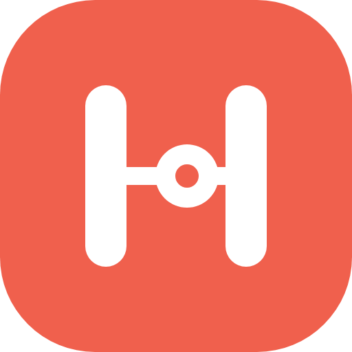
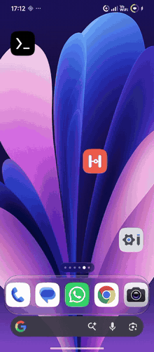
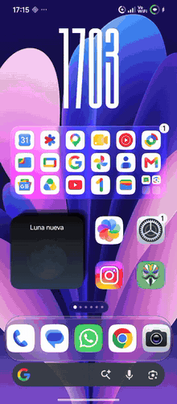
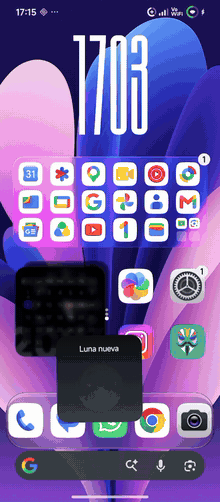
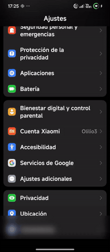
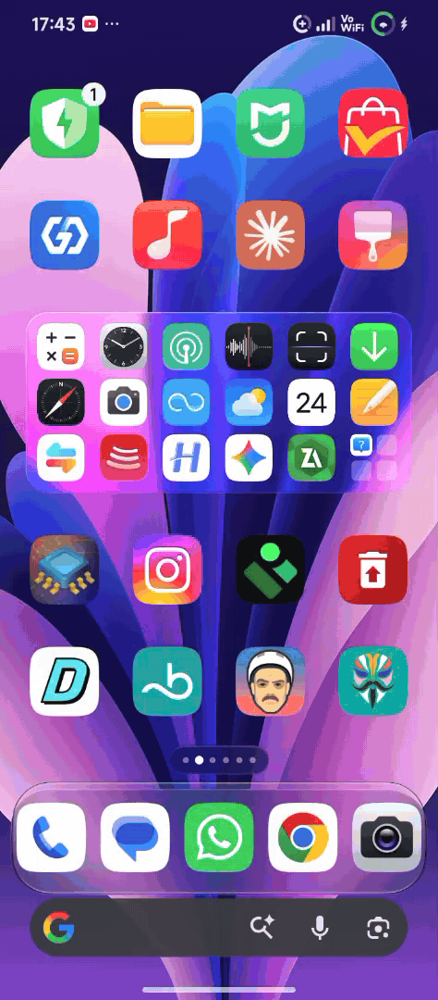
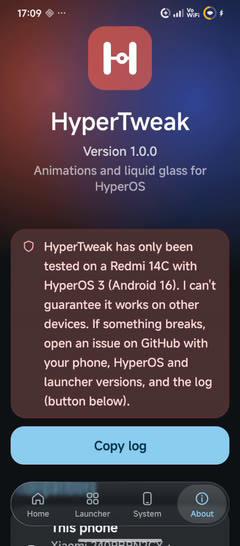

  

<h1 align="center">HyperTweak</h1>

  Animations and liquid glass for HyperOS · LSPosed module 
  <b>v1.0.0</b> · <a href="README.es.md">Español</a>

---

> **A Note on Development:**  
> This project was initially built using AI to prototype the core concepts quickly. However, I am currently learning Java and **looking forward to** refactoring, maintaining, and coding everything myself as I grow as a developer! Feedback and contributions are more than welcome.

HyperTweak adds two kinds of things to HyperOS:
- **Launcher and System UI animations** that it doesn't ship with.
- **A liquid-glass control center** with edge refraction.

It doesn't modify any APK: everything runs through LSPosed. Sliders apply live from the app; turning a feature on or off needs a quick launcher or System UI restart.

> [!WARNING]
> **Only tested on a Redmi 14C with HyperOS 3 (Android 16).** I can't guarantee it works on other devices.
> - **If something breaks:** please open an [issue](../../issues) and paste the log from **About → Copy log**. It already includes your phone and the HyperOS and launcher versions.
> - **If a part fails on your device:** each feature is installed separately, so the error is written to the log and the rest keeps working.
> - **If the launcher or System UI crashes repeatedly:** HyperTweak turns itself off in that part (see [Safe mode](#safe-mode)).

## Preview

<table>
  <tr>
    <th>Opening and closing apps</th>
    <th>Folders and widget stack</th>
    <th>Bending recents</th>
  </tr>
  <tr>
    <td></td>
    <td></td>
    <td></td>
  </tr>
</table>

<table>
  <tr>
    <th>Curtain between screens</th>
    <th>Liquid-glass control center with the Mods Center iOS Control Center</th>
    <th>The app</th>
  </tr>
  <tr>
    <td></td>
    <td></td>
    <td></td>
  </tr>
</table>

Tap a GIF or the app screenshot to watch the full video at up to 60 fps. The GIFs are shortened and run at a lower frame rate to keep them light. Recorded with scrcpy on a Redmi 14C with HyperOS 3.

## Requirements

| | |
|---|---|
| **System** | HyperOS 2 or 3 (Android 13 or newer). The glass and refraction need Android 13+. |
| **Root** | Magisk, KernelSU or APatch. Grant root to the HyperTweak app so the restart buttons work instantly. |
| **LSPosed** | LSPosed (Zygisk) or a current fork such as JingMatrix/Vector. Xposed API 93+. |
| **Scopes** | `com.miui.home` (System launcher) and `com.android.systemui` (System UI). If LSPosed lists it, also tick `miui.systemui.plugin`. |

### Tested with

- **Phone:** Redmi 14C (Helio G81 Ultra, Mali-G52 MC2) on HyperOS 3 (Android 16).
- **Kashi's mods from Mods Center:** *HyperOS Launcher Mod 7.5* (launcher) and *iOS Control Center* (control center).

**The Mods Center mods are not required.** HyperTweak also works with the stock HyperOS launcher and control center. The widget stack and the springy folders hook features of Kashi's launcher, so with the stock launcher those two do nothing.

## Features

### Launcher (`com.miui.home`)
- **Genie effect when opening and closing apps.**
  - The window comes out of its icon and goes back into it as a cup.
  - The top leads and the bottom follows, adapting to where the icon sits on screen.
  - Three styles: classic genie, Samsung-like cup and "Ice" (softer, with a bounce).
  - Drawn with OpenGL on its own thread so it stays smooth on mid-range phones.
- **Drag to close like a lamp:** the window hangs from your finger and swings.
- **Bending recents:** cards bend depending on how hard you swipe.
- **Sinking icons** when pressed, and **wallpaper zoom** when opening apps.
- **Folders** with blurred glass and a springy resize.
- **Widget stack** you can shuffle and drag freely.

### System UI (`com.android.systemui`)
- **Curtain:** when you switch screens inside an app, the window tilts with its speed and the one below blurs.
- **Liquid-glass control center:**
  - Blur, saturation, magnifier and gloss.
  - An edge lit with the colour of what's behind it.
  - **Edge refraction** with colour dispersion, based on the [AndroidLiquidGlass](https://github.com/Kyant0/AndroidLiquidGlass) lens.

### The app
- **Look:** system colours (Monet), a floating liquid-glass bar, an animated dot-network background and a dark theme.
- **Language:** English or Spanish depending on your phone's language. You can change it in **About → Language**.
- **Every setting explains itself:** tap a row to expand its description, and long-press it to reset it to its default.
- **Compatibility card** in **About**: your Android and HyperOS versions, the launcher and control center versions, and whether HyperTweak is active in each part.
- **Log** of the launcher and System UI, to copy when reporting a problem.

## Installation

1. Install the APK from [Releases](../../releases).
2. In LSPosed, enable **HyperTweak** and tick the **System launcher** and **System UI** scopes.
3. Reboot.
4. Open HyperTweak and grant root when asked (it's only used to restart the launcher and
